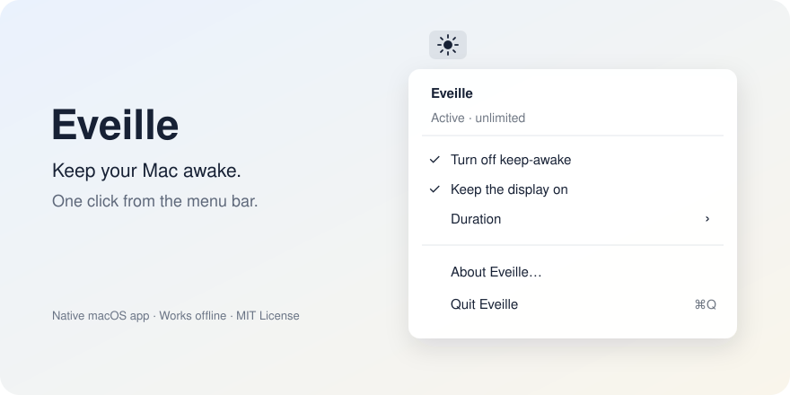

# Eveille

**Keep your Mac awake. One click from the menu bar.**

Eveille is a small native macOS app for long-running tasks: coding, rendering,
downloads, presentations, or anything you want to leave running while you step away.



*Menu illustration; appearance follows your macOS version and theme.*

## Features

- Keep your Mac awake until you turn it off or quit.
- Choose a session length: 30 minutes, 1 hour, 2 hours, 4 hours, or unlimited.
- Keep the display on, or let it turn off while the Mac stays awake.
- See the remaining time in the menu.
- Remember your selected duration and display preference.
- Work offline, with no account, telemetry, or third-party dependencies.

Eveille uses Apple's power-management APIs. It does not change your system sleep
settings or simulate keyboard and mouse activity.

## Requirements

- macOS 13 Ventura or later.
- An Apple Silicon or Intel Mac.
- To build: Apple's Command Line Tools with Swift 5.7 or later, or a compatible Xcode installation.

## Build and run

Clone or download this repository, then run these commands from its root:

```sh
./scripts/test.sh
./scripts/build.sh
open build/Eveille.app
```

If you do not have Apple's developer tools, install them with `xcode-select --install`.

The default build targets your current Mac. To build a universal app for Apple
Silicon and Intel:

```sh
./scripts/build.sh --universal
```

The app is written to `build/Eveille.app`. A ZIP and its SHA-256 checksum are written
to `dist/`. You can move the app to your Applications folder.

### Downloaded builds

This initial version is **ad hoc signed, not Developer ID signed or notarized**.
macOS may block a copy downloaded from the internet. Building from source is the
recommended installation path until a notarized release is available. See
[Apple's explanation of notarization](https://developer.apple.com/documentation/security/notarizing-macos-software-before-distribution).

## Use

1. Open Eveille. A sun appears in the menu bar and keep-awake starts immediately.
2. Click the sun to open the menu.
3. Choose **Duration** to set a time limit. Changing duration restarts the countdown.
4. Uncheck **Keep the display on** if you only want the Mac itself to stay awake.
5. Choose **Turn off keep-awake** to pause, or **Quit Eveille** to stop the app.

The moon icon means keep-awake is inactive. When a timed session ends, Eveille stays
in the menu bar but releases its power assertion. macOS then follows its usual sleep
timers; Eveille does not force the Mac to sleep.

Your last duration and display preference are restored on launch. Every launch
starts a new session, even if you turned keep-awake off before quitting.
Eveille does not add itself to Login Items.

## Limits

- Keep the laptop lid open. Eveille does not provide closed-lid operation.
- Manual sleep and manual screen locking remain available. macOS may also sleep
  for system reasons, such as critically low power.
- Keeping the display on can postpone automatic locking tied to display sleep.
  You can still lock manually with **Control–Command–Q**.
- Other apps may still wait for input or authorization. Keeping the Mac awake
  does not answer their prompts or guarantee that a task completes.
- Other apps can also prevent sleep. Quitting Eveille only releases its own assertion.

## Development

The app uses AppKit for the menu and IOKit for power assertions. No package manager
or Xcode project is required.

```text
Sources/AwakeSession.swift   Power assertion ownership and session deadlines
Sources/main.swift          Menu bar interface and saved preferences
Tests/main.swift            Real macOS assertion and timer checks
Resources/Info.plist        App bundle metadata
scripts/build.sh            Native/universal compilation and packaging
scripts/test.sh             Compile and run the tests
```

The tests exercise actual macOS assertions and an injected clock, so timer expiry
can be checked immediately. They release all assertions before exiting.
GitHub Actions is configured to run tests and build a universal package on macOS.
It does not notarize or publish releases automatically.

The current version has been compiled for both architectures and tested locally
on Apple Silicon. Intel execution, older macOS versions, and the manual interface
checklist still need verification; see [release preparation](docs/RELEASING.md).

Contributions are welcome. See [CONTRIBUTING.md](CONTRIBUTING.md) and
[CHANGELOG.md](CHANGELOG.md).

## Origin

Eveille started when a game happened to keep a Mac awake during long tasks.
This app turns that useful side effect into a small, explicit control.
Built with assistance from OpenAI Codex.

## License

[MIT](LICENSE). Copyright © 2026 damani42.
